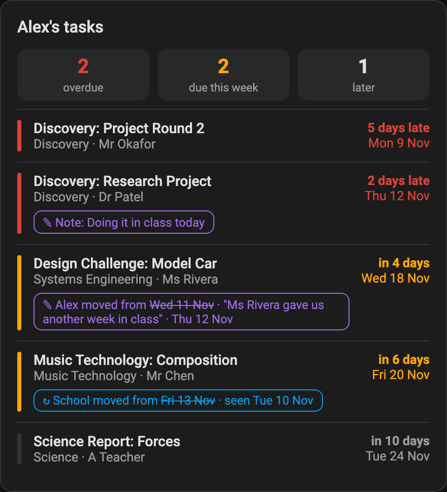
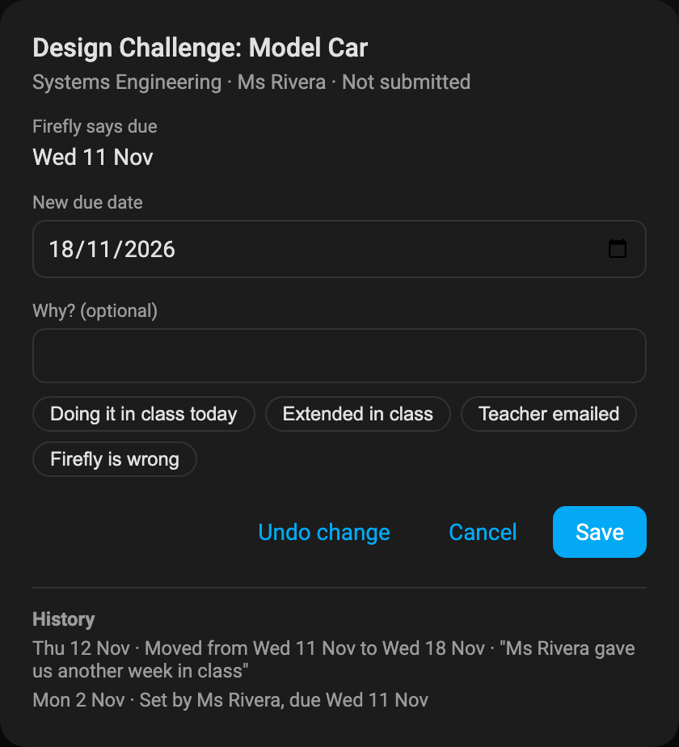
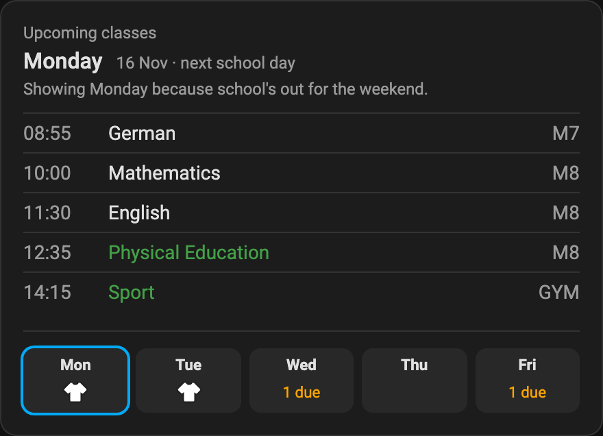

# Home Assistant Firefly Cloud Integration

[](https://github.com/matt-richardson/home-assistant-firefly-cloud/actions/workflows/test.yml)

A Home Assistant custom integration that connects to Firefly Cloud (school learning platform) to display children's school schedules and upcoming tasks on your smart home dashboard.

## Features

- **Upcoming Tasks**: Monitor homework, projects, and assignments with due dates
- **Tasks Due Today**: Quick view of today's due assignments
- **Overdue Tasks**: Track assignments past their due date with days overdue
- **Current/Next Class**: Real-time school schedule showing current and upcoming lessons
- **Calendar Integration**: School events and tasks displayed in Home Assistant calendar
- **Todo Integration**: Interactive todo list for managing school tasks
- **Multi-Child Support**: Family dashboard view or individual child dashboards

## Supported versions

Tested in CI on **Python 3.11–3.14** against **Home Assistant 2024.3 through 2026.6+**
(HA 2024.3.x on Python 3.11/3.12; current HA on Python 3.13/3.14).

## Installation

### HACS (Recommended)

[](https://my.home-assistant.io/redirect/hacs_repository/?owner=matt-richardson&repository=home-assistant-firefly-cloud&category=integration)

1. **Add Repository**: Use the badge above or manually add `matt-richardson/home-assistant-firefly-cloud` as a custom repository in HACS
2. **Install**: Search for "Firefly Cloud" in HACS and install
3. **Restart**: Restart Home Assistant
4. **Configure**: Add the integration through Settings > Devices & Services

### Manual Installation
1. Copy the `custom_components/firefly_cloud/` folder to your Home Assistant `custom_components/` directory
2. Restart Home Assistant
3. Add the integration through Settings > Devices & Services

## Configuration

1. In Home Assistant, go to Settings > Devices & Services
2. Click "Add Integration" and search for "Firefly Cloud"
3. Enter your school's Firefly code
4. Follow the browser authentication flow to log into Firefly
5. The integration will automatically discover your children and create sensors

### Configuration Options

After setup, you can configure additional options by clicking "Configure" on the integration:

- **Task Lookahead Days**: Number of days ahead to look for upcoming tasks (1-30 days). Default: 7 days.
- **Show Class Times**: Display time prefixes for current and next class sensors (e.g., "09.00-10.00: Mathematics" instead of just "Mathematics"). Default: disabled.

## Entities Created

For each child, the integration creates:
- `sensor.firefly_upcoming_tasks_[child_name]` - Tasks due in configured timeframe
- `sensor.firefly_tasks_due_today_[child_name]` - Tasks due today
- `sensor.firefly_overdue_tasks_[child_name]` - Tasks past their due date
- `sensor.firefly_current_class_[child_name]` - Currently active class/lesson
- `sensor.firefly_next_class_[child_name]` - Next scheduled class/lesson
- `calendar.firefly_[child_name]` - School events and tasks in calendar format
- `todo.firefly_[child_name]` - Interactive todo list for school tasks

## Dashboard Usage

The entities provide rich data perfect for Home Assistant dashboard cards:
- Task lists grouped by subject and due date with sensor attributes
- Overdue task notifications and counts
- Real-time class schedule with current and next lesson information
- Calendar view of school events and deadlines
- Interactive todo lists for task management

## Dashboard cards

The integration ships two dashboard cards. There's nothing extra to install: add them from the card picker (search "Firefly") or in YAML. Use one of each per child.

### Tasks card

 

Lists the child's open tasks with counts (overdue, due this week, later), the subject, teacher and how late or how far away each one is.

Tap a task to change its due date or add a note, with an optional reason (quick reasons such as "Doing it in class today" are offered). The change counts straight away in the card and the sensors, and is always marked on the task. Firefly itself isn't changed: if the school later changes the date in Firefly, the school's date wins and the change moves into the task's history. Undo is kept in the history too.

```yaml
type: custom:firefly-tasks-card
entity: todo.example_school_tasks_alex
title: Alex's tasks          # optional
changed_by_label: Alex       # optional: tags read "Alex moved from…" instead of "Changed on dashboard from…"
```

### Upcoming classes card



Shows the next school day's lessons with times and rooms, with kit lessons such as PE highlighted. After the last lesson, at weekends and in holidays it moves on to the next day with lessons. A strip underneath shows the coming school days, with kit days and tasks due; tap a day to see it.

```yaml
type: custom:firefly-classes-card
entity: todo.example_school_tasks_alex
kit_subjects:                 # optional; default: PE, Physical Education, Sport, Games, Swimming
  - PE
  - Sport
hide_subjects:                # optional; default: hide nothing
  - Middle School Pastoral Program
```

### Services

The tasks card uses these services, which you can also call from scripts and automations:

- `firefly_cloud.set_task_due_date`: target the child's Firefly tasks list, and give `task_id` and a new `due_date` and/or a `reason`. A reason without a date is saved as a note.
- `firefly_cloud.clear_task_due_date`: target the tasks list and give `task_id`. Undoes the change (kept in the history).

```yaml
action: firefly_cloud.set_task_due_date
target:
  entity_id: todo.example_school_tasks_alex
data:
  task_id: "69040"
  due_date: "2026-11-18"
  reason: Extended in class
```

Sensor task attributes include `firefly_due_date`, `due_date_changed` and `due_date_change_reason`; `due_date` is the date in force.

## Target Quality

This integration is designed to meet Home Assistant's Silver-tier quality standards, including:
- Comprehensive test coverage (>95%)
- Proper error handling and recovery
- UI-based reauthentication
- Modern Python async implementation

## Support

For issues, feature requests, or questions, please use the GitHub Issues tab.

## Development

### Dev Container Setup (Recommended)

This project includes a complete development container setup for VS Code that provides:

- **Python 3.11 Environment**: Pre-configured with all dependencies
- **Home Assistant Test Instance**: Automatic setup with integration pre-linked
- **Testing Framework**: pytest with async support and coverage reporting (>95% target)
- **Code Quality Tools**: black, flake8, mypy, pylint pre-configured
- **VS Code Extensions**: Python development, YAML, and debugging tools
- **Port Forwarding**: Home Assistant accessible at http://localhost:8123

#### Quick Start with Dev Container

1. **Prerequisites**: Install Docker and VS Code with Dev Containers extension
2. **Open Project**: Open this directory in VS Code
3. **Start Container**: Command Palette > "Dev Containers: Reopen in Container"
4. **Wait for Setup**: Automatic dependency installation and environment configuration
5. **Start Developing**: Use the helper commands below

#### Development Commands

Use the `./dev.sh` helper script for common development tasks:

```bash
./dev.sh test          # Run all tests
./dev.sh test-cov      # Run tests with coverage (Silver tier: >95%)
./dev.sh test-single   # Run specific test function
./dev.sh lint          # Run all linting tools (black, flake8, mypy, pylint)
./dev.sh format        # Format code with black and isort
./dev.sh validate      # Full validation suite (format + lint + test)
./dev.sh ha-test       # Start Home Assistant test instance
./dev.sh clean         # Clean temporary files and caches
```

#### Manual Testing Workflow

The dev container provides multiple approaches for manual testing:

**1. Unit and Integration Tests**
```bash
./dev.sh test-cov      # Run full test suite with coverage
./dev.sh test-single test_authentication  # Run specific test
```

**2. Home Assistant Integration Testing**
```bash
./dev.sh ha-test       # Start Home Assistant test instance
```
- Navigate to http://localhost:8123
- Integration pre-installed and symlinked
- Add Firefly Cloud through Settings > Devices & Services
- Complete authentication flow with real Firefly credentials
- Verify five sensors are created for each child
- Debug logging enabled for troubleshooting

**3. VS Code Testing Features**
- **Test Explorer**: Run/debug tests directly in VS Code interface
- **Python Debugger**: Set breakpoints in integration code
- **Port Forwarding**: Home Assistant automatically accessible at localhost:8123
- **Auto-formatting**: Code formatted on save with black/isort

**4. Manual Entity Validation**
After adding integration, verify entities are created:
- `sensor.firefly_upcoming_tasks_*` - Homework and assignments
- `sensor.firefly_tasks_due_today_*` - Today's due tasks
- `sensor.firefly_overdue_tasks_*` - Tasks past their due date
- `sensor.firefly_current_class_*` - Currently active class/lesson
- `sensor.firefly_next_class_*` - Next scheduled class/lesson
- `calendar.firefly_*` - School events and tasks in calendar
- `todo.firefly_*` - Interactive todo list for tasks

**5. Error Scenario Testing**
Test integration behavior with:
- Invalid school codes
- Network connectivity issues
- Authentication token expiry
- API rate limiting responses

#### File Structure in Dev Container

```
/workspace/
├── custom_components/firefly_cloud/    # Integration source code
├── tests/                              # Comprehensive test suite
├── homeassistant_test/                 # Home Assistant test instance
│   ├── configuration.yaml             # Test configuration
│   └── custom_components/              # Integration symlinked here
├── .devcontainer/                      # Dev container configuration
└── dev.sh                             # Development helper script
```

### Manual Development Setup

If not using the dev container, you'll need:

1. **Python 3.11+** with pip
2. **Virtual Environment**:
   ```bash
   python -m venv venv
   source venv/bin/activate
   ```
3. **Dependencies**: `pip install homeassistant aiohttp lxml python-dateutil voluptuous`
4. **Development Tools**: `pip install pytest pytest-asyncio pytest-cov black flake8 mypy pylint pre-commit`
5. **Pre-commit Hooks** (recommended):
   ```bash
   ./setup-pre-commit.sh
   ```
   This installs git hooks that automatically run code quality checks (black, isort, flake8, mypy) before each commit.
6. **Testing**: Run `pytest tests/` from the project root

### CI/CD Pipeline

This project uses GitHub Actions for continuous integration and testing:

**Automated Testing**
- Tests run on every pull request and push to main
- Multi-version testing: Python 3.11, 3.12, 3.13, and 3.14
- Code coverage requirement: >95%
- Linting: black, flake8, pylint, mypy
- Integration validation: HACS and Hassfest

**Branch Protection**
- Main branch is protected with required status checks
- PRs (including release PRs) cannot be merged until all tests pass

### Contributing

This project uses automated release management via [release-please](https://github.com/googleapis/release-please).

**Commit Message Format**

All commits must follow [Conventional Commits](https://conventionalcommits.org) format:

```
<type>: <description>

[optional body]
```

**Commit Types:**
- `feat:` - New feature (triggers minor version bump)
- `fix:` - Bug fix (triggers patch version bump)
- `docs:` - Documentation changes
- `chore:` - Maintenance tasks, dependency updates
- `refactor:` - Code refactoring
- `test:` - Test additions or modifications
- `ci:` - CI/CD configuration changes

**Examples:**
```bash
git commit -m "feat: add sensor for current class schedule"
git commit -m "fix: resolve timezone handling for next class sensor"
git commit -m "docs: update installation instructions"
```

**Breaking Changes:**
Add `BREAKING CHANGE:` in the commit footer to trigger a major version bump:
```bash
git commit -m "feat!: remove deprecated API

BREAKING CHANGE: The old API endpoints have been removed."
```

**Release Process:**
1. Commits following conventional format are pushed to `main`
2. Release-please automatically creates/updates a release PR
3. Merge the release PR to publish a new release
4. Versions are automatically bumped in [manifest.json](./custom_components/firefly_cloud/manifest.json) and [CHANGELOG.md](./CHANGELOG.md)

A git commit-msg hook is included to validate commit messages locally.

### Additional Resources

- [CLAUDE.md](./CLAUDE.md) - Development guidance and architecture overview
- [firefly-cloud-technical-spec.md](./docs/firefly-cloud-technical-spec.md) - Detailed technical specifications
- [.devcontainer/README.md](./.devcontainer/README.md) - Complete dev container documentation

## License

Released under the [MIT License](LICENSE).
